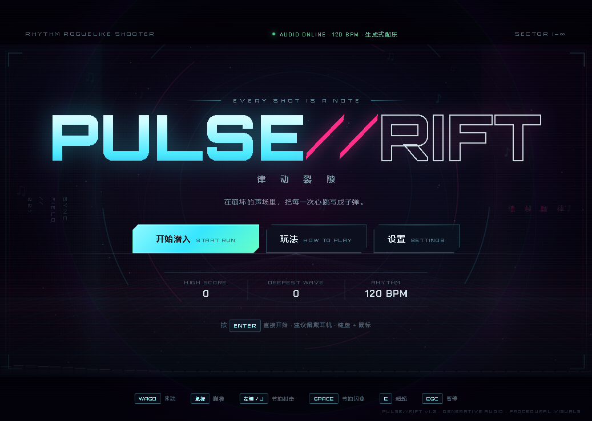
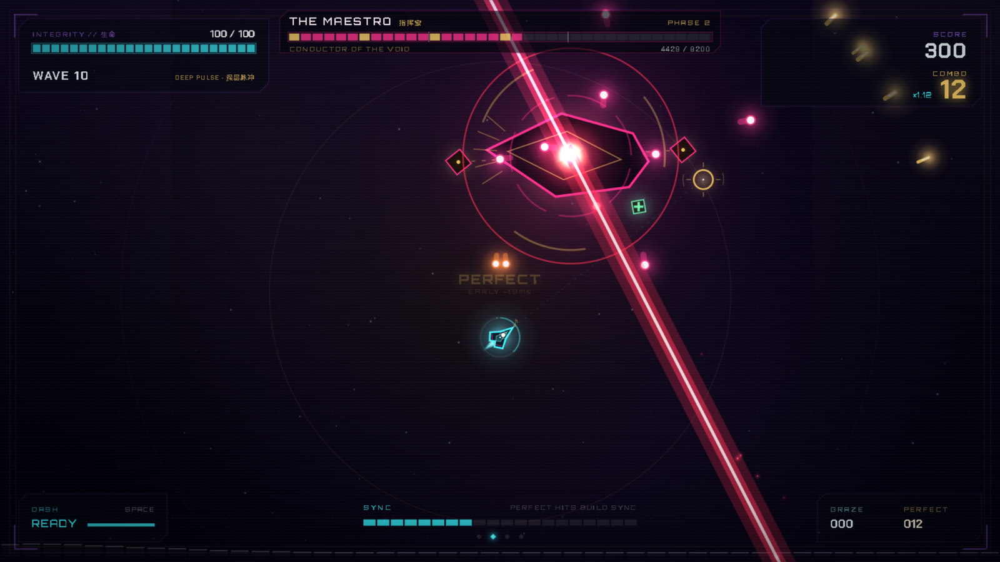
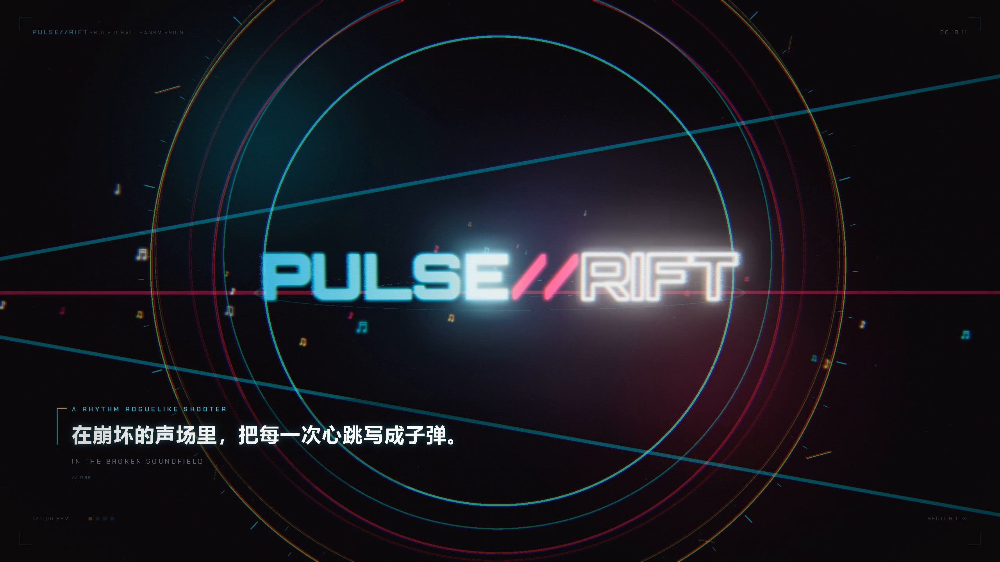

# PULSE//RIFT · 律动裂隙

> **EVERY SHOT IS A NOTE.**
> 在崩坏的声场里，把每一次心跳写成子弹。

本仓库包含同一项目的两个部分：

| 目录 | 内容 |
|---|---|
| [`pulse-rift/`](pulse-rift/) | 可玩的浏览器 **节奏 × 肉鸽 × 双摇杆射击** 游戏，纯 HTML/CSS/JS，无构建步骤 |
| [`pulse-rift-promo/`](pulse-rift-promo/) | 96 秒程序化宣传片与 gameplay 展示片：Three.js/WebGL 画面与 Web Audio 音乐全部由代码生成 |

## 游戏

用 Chrome / Edge 打开 [`pulse-rift/index.html`](pulse-rift/index.html)，或双击 `pulse-rift/play.bat`。
首次点击解锁 Web Audio，建议佩戴耳机。玩法、判定与强化说明见
[游戏 README](pulse-rift/README.md)。

## 宣传片

120 BPM、48 小节、12 × 8 秒分段渲染，剪辑点全部落在节拍网格上；另有四支真实游戏内录制的
gameplay 展示片。完整的镜头表、音频合成与重建流程见
[promo docs](pulse-rift-promo/README.md)。

## 仓库说明

- 依赖：`cd pulse-rift-promo && npm install`（Playwright / Three.js / muxers）。
- 原始录制素材、成片视频与 `node_modules` 由 [`.gitignore`](.gitignore) 排除；
  成片通过 GitHub Releases 分发。
- 游戏本体不需要安装任何依赖，直接用浏览器打开即可。
